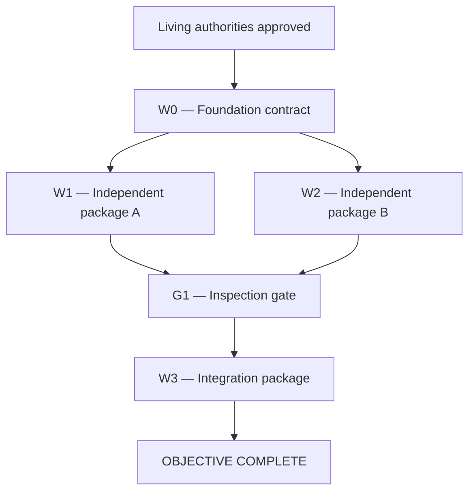

# Blueprint Masterplan Template

## Contents

- Blueprint template
- Graph rules
- Worker brief rules
- Gate rules
- Revision rules

## Blueprint template

Adapt vocabulary and paths to the project. Preserve every section responsibility.

````markdown
# <Project> <Objective> Implementation Masterplan

> Frozen execution blueprint for delivering <bounded outcome> through independently owned worker packages.

| Field | Value |
| --- | --- |
| Status | Approved execution snapshot |
| Effective date | <date> |
| Integration authority | `<remote>/<base-branch>` |
| Coordinator | <role or named owner> |
| Business authority | `<relative path>` |
| Product authority | `<relative path>` |
| Architecture authority | `<relative path>` |
| Implementation authority | `<relative path>` |
| Historical task artifacts | `<relative path>` |
| Coordination status | `<relative path to STATUS.md>` |

## 1. How to use this document

State the one execution question this blueprint answers. Explain that living masterplans remain authoritative for product, business, architecture, and current implementation truth.

Every worker receives:

1. this blueprint;
2. all relevant living masterplans;
3. its worker ID and bounded brief;
4. prerequisite handoffs;
5. the current repository and remote integration branch; and
6. its unique status-file path.

No worker depends on private conversation history or an unmerged implementation branch.

## 2. Outcome and delivery gates

Describe the final bounded outcome and any ordered inspection gates.

| Gate | Outcome | Hard prerequisites | Evidence | Unlocks |
| --- | --- | --- | --- | --- |
| <G1> | <observable milestone> | <worker/gate IDs> | <commands, artifacts, or approval> | <worker/gate/release IDs> |

Omit gates that have no measurable evidence or downstream consequence.

## 3. Foundation already implemented

List existing modules, infrastructure, components, contracts, migrations, and operational patterns workers must reuse. Cite living authorities and repository paths.

State explicitly which foundations workers may not duplicate for local convenience.

## 4. Locked boundaries and ownership rules

List the product, domain, security, integration, data, and operational boundaries that determine worker interfaces.

### 4.1 Shared mutable surfaces

| Surface | Single owner | Dependants | Change protocol |
| --- | --- | --- | --- |
| <contract, migration sequence, generated output, central file> | <worker ID> | <worker IDs> | <merge/evidence required before use> |

## 5. Execution graph



Every arrow is a hard prerequisite satisfied only by remote integration and required evidence. Describe coordination-only relationships outside the hard-dependency graph.

## 6. Readiness and blocker rules

- `not-ready`: at least one hard prerequisite is not integrated.
- `ready`: every hard prerequisite and required contract is integrated.
- `in-progress`: the worker has claimed its branch, worktree, and status file.
- `blocked`: a named dependency, decision, conflict, or external change prevents progress.
- `review`: implementation exists but required review, evidence, or integration is open.
- `complete`: the coordinator verified integration evidence and teardown receipt.

Remote integration state is authoritative. A local “done” claim or pushed feature branch does not unblock a dependant.

## 7. Mandatory lifecycle for every worker

### 7.1 Superpowers flow

1. Load applicable skills and inspect the current repository.
2. Brainstorm and approve a dated task specification.
3. Write the dated implementation plan.
4. Update affected living masterplans with stable approved contracts.
5. Implement with test-driven development where applicable.
6. Request and address review.
7. Run verification-before-completion.
8. Integrate through the approved path.
9. Hand off evidence and perform safe teardown.

### 7.2 Worktree isolation

Use one branch and isolated worktree per local worker. Prefer native platform worktree support; otherwise use an ignored project-local `.worktrees/<worker-id>` path after verifying isolation and a clean baseline.

Use separate clones for separate machines or incompatible environments, not ordinary same-machine parallelism.

### 7.3 Substep Git synchronization

After every completed plan substep:

1. run focused verification;
2. update only the worker-owned status file;
3. commit only owned verified changes;
4. fetch the remote integration branch;
5. rebase or incorporate current integration state;
6. resolve mechanical conflicts without discarding another worker's intent;
7. stop on semantic, ownership, contract, generated-file, or migration conflicts;
8. rerun affected checks; and
9. push the worker branch before the next substep.

Do not merge every substep into the base branch. Merge at contract/dependency boundaries, completed packages, or inspection gates.

### 7.4 Prerequisite gate

A prerequisite is satisfied only when its commits and evidence are reachable from the remote integration branch. A dependant may inspect an open branch for coordination but must not implement against it as an authority.

## 8. Worker packages

### Worker <ID> — <task and outcome>

**Depends on:** <worker/gate IDs or approved living authorities>.

**Owns:** <paths, contracts, records, migrations, generated artifacts, tests, status file>.

**Does not own:** <nearby shared or dependant surfaces>.

**Coordinates with:** <owners and contract boundaries that are not hard dependencies>.

**Work:**

- <bounded deliverable>
- <bounded deliverable>
- <living-authority update when stable decisions change>

**Acceptance evidence:**

- <exact test, review, artifact, or observable result>
- <negative or conflict-safety evidence>

**Merge condition:** <what must be approved and green before integration>.

**Unblocks:** <worker/gate IDs and the contract or evidence supplied>.

Repeat for every worker. Keep one clear outcome per worker package.

## 9. Shared integration contracts

For every contract used by at least two workers, state:

- its owner and canonical file or schema;
- consumers;
- compatibility or migration rules;
- validation evidence;
- when changes may merge; and
- how semantic conflicts are escalated.

## 10. Integration gates

### Gate <ID> — <name>

**Purpose:** <inspection or release decision>.

**Prerequisites:** <worker/gate IDs>.

**Acceptance evidence:**

- <observable criterion and exact evidence>
- <observable criterion and exact evidence>

**Verifier:** <role or named owner>.

**On failure:** <owner, remediation path, and blocked downstream nodes>.

**Unlocks:** <worker/gate/release IDs>.

## 11. Coordination status

- Every worker owns `docs/workers/<blueprint-id>/status/<worker-id>.md` on its branch.
- The coordinator alone owns `docs/workers/<blueprint-id>/STATUS.md`.
- The coordinator fetches active remote branches before reporting readiness or blockers.
- The aggregate records critical path, stale status, verification gaps, gate state, newly unblocked work, and teardown receipts.

## 12. Merge and conflict policy

- Use narrow feature branches and unique worktrees.
- Treat the named remote base branch as the only integration authority.
- Assign each shared mutable surface one owner.
- Merge foundation contracts early only when their verification unblocks dependants.
- Regenerate generated files from their authority; do not hand-merge incompatible output.
- Coordinate migration ordering through the remote base branch.
- Resolve mechanical conflicts inside ownership and reverify.
- Stop on semantic or cross-owner conflicts and update affected living authorities after approval.
- Never reset, overwrite, or discard another worker's change to make integration pass.

## 13. Completion, handoff, and teardown

A worker handoff includes:

- worker ID, branch, final commit, and base branch;
- task specification and implementation plan;
- living-masterplan commits;
- verification commands and fresh results;
- migrations, generated artifacts, or operational actions;
- conflict resolutions;
- limitations and deferred work; and
- downstream work now unblocked.

After integration:

1. prove the final worker commit is reachable from the remote base branch;
2. verify the integrated result or required CI evidence;
3. preserve the merged handoff and archival status;
4. confirm the worker worktree is clean;
5. remove only the worker-owned worktree without force;
6. prune stale worktree registrations;
7. safely delete the merged local feature branch;
8. delete its remote feature branch; and
9. give the coordinator a cleanup receipt.

If work is dirty, unmerged, failing, or under review, stop cleanup and report the blocker. Never use forced worktree removal or forced branch deletion for normal completion.

## 14. Explicit exclusions

List adjacent products, deferred capabilities, speculative infrastructure, and future gates that must not delay the bounded objective.

## 15. Revision policy

Ordinary progress updates worker status, not this frozen blueprint. If a new stable decision changes ownership, dependencies, gates, or scope:

1. update and commit affected living masterplans;
2. identify invalidated worker assumptions;
3. issue an explicit blueprint revision or replacement;
4. update the graph, briefs, status baseline, and downstream readiness together; and
5. obtain approval before workers proceed under the changed contract.
````

## Graph rules

- Use a directed acyclic graph.
- Give every node a stable ID used consistently in the diagram, briefs, gates, and status files.
- Draw hard dependencies only; label coordination relationships separately.
- Make gates distinct nodes.
- Give each non-root node a justified predecessor or state explicitly that it may start immediately.
- Verify every arrow against the written `Depends on` and `Unblocks` fields.
- If a cycle appears, redesign ownership or interfaces; do not hide the cycle in prose.

## Worker brief rules

- One worker package owns one coherent outcome.
- One shared mutable surface has one owner.
- File-level ownership is evidence, not the sole boundary; include contracts, records, migrations, and generated artifacts.
- Dependants consume merged contracts, not copied branch code.
- Acceptance evidence names exact commands, artifacts, negative cases, or approvals.
- A worker that only “helps integrate” still needs owned surfaces and acceptance evidence.

## Gate rules

- Add a gate only when the user wants it or a real inspection/release decision is necessary.
- Require measurable evidence and a verifier.
- Name every upstream prerequisite and downstream consequence.
- Define failure ownership and remediation.
- Do not call an arbitrary project phase a gate.

## Revision rules

A frozen blueprint may receive clarifications that do not change behavior. A change to scope, dependency edges, ownership, gate criteria, or completion semantics requires an explicit revision after living authorities are current.
