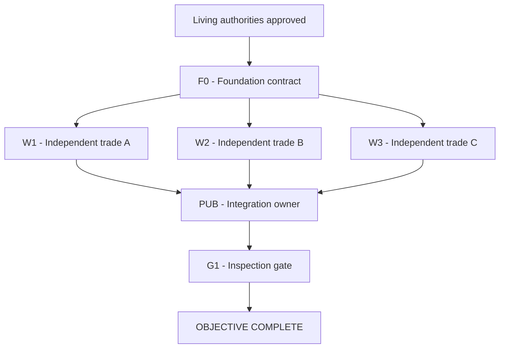

# Blueprint Masterplan Template

## Contents

- Blueprint template
- Graph rules
- Worker brief rules
- Gate rules
- Revision rules

## Blueprint template

Adapt vocabulary and paths to the project. Preserve every section responsibility. Keep worker-level step-by-step specifications and implementation plans outside this masterplan.

````markdown
# <Project> <Objective> Implementation Masterplan

> Frozen execution blueprint for delivering <bounded outcome> through independently owned worker packages.

| Field | Value |
| --- | --- |
| Status | Approved execution snapshot |
| Blueprint ID | `YYYY-MM-DD-<short-slug>` |
| Effective date | <date> |
| Integration authority | `origin/main` |
| Same-checkout mutation lock | `<exact serialization mechanism>` |
| Cross-checkout main-push lock or queue | `<exact serialization mechanism>` |
| Coordinator | <role or named owner> |
| Business authority | `<relative path>` |
| Product authority | `<relative path>` |
| Architecture authority | `<relative path>` |
| Existing implementation authority | `<relative path>` |
| Worker specification root | `docs/superpowers/specs/<blueprint-id>/` |
| Worker implementation-plan root | `docs/superpowers/plans/<blueprint-id>/` |
| Coordination root | `docs/workers/<blueprint-id>/` |

## 1. How to use this document

State the one execution question this blueprint answers. Explain that living masterplans own approved behavior and current truth; this frozen document owns delivery boundaries, dependencies, gates, and integration mechanics.

Every worker receives:

1. this blueprint;
2. relevant living authorities;
3. its worker ID and bounded brief;
4. prerequisite handoffs;
5. the assigned normal checkout or clone on `main`; and
6. the main-mutation/main-push lock mechanisms and reserved artifact/status paths.

No worker depends on private conversation history, off-main work, or an unpushed local commit. Each worker authors its own detailed specification and implementation plan after its prerequisites are integrated. Feature branches and linked Git worktrees are prohibited.

## 2. Outcome and delivery gates

Describe the final bounded outcome and measurable inspection/release gates.

| Gate | Outcome | Hard prerequisites | Evidence | Verifier | Unlocks |
| --- | --- | --- | --- | --- | --- |
| <G1> | <observable milestone> | <worker/gate IDs> | <commands, artifacts, or approval> | <owner> | <IDs> |

Omit a gate without measurable evidence, a verifier, failure ownership, and a downstream consequence.

## 3. Foundation already implemented

List existing modules, infrastructure, components, contracts, migrations, tests, and operational patterns workers must reuse. Cite authorities and repository paths.

State which foundations workers may not duplicate for local convenience.

## 4. Locked boundaries and ownership rules

List the approved product, architecture, security, integration, data, and operational boundaries that determine worker interfaces.

### 4.1 Shared mutable surfaces

| Surface | Single owner | Dependants | Change protocol |
| --- | --- | --- | --- |
| <contract, migration sequence, generated output, central file> | <worker ID> | <IDs> | <merge/evidence required before use> |

## 5. Execution graph



Every arrow is a hard prerequisite satisfied only by remote integration and required evidence. Describe coordination-only relationships outside the graph.

### 5.1 Graph-shape evidence

| Metric | Value | Explanation |
| --- | --- | --- |
| Worker nodes | <count> | <why every package is coherent> |
| Hard dependency edges | <count> | <why every edge requires remote integration> |
| Substantive layer widths | <counts and worker IDs> | <ready frontiers by graph state> |
| Peak ready width | <count and IDs> | <widest logical frontier> |
| Active execution-slot limit | <count> | <capacity, separate from graph width> |
| Width exceptions | <none or layers> | <structural reason outside three to seven> |

For a multi-worker objective, target three to seven concurrently ready workers in each substantive post-foundation trade layer. Do not force roots, joins, gates, closeout, or small objectives into the band. Group related micro-surfaces rather than inventing dependencies.

### 5.2 Dependency and unblock parity

| ID | Depends on | Unblocks |
| --- | --- | --- |
| <ID> | <IDs or approved authorities> | <IDs and supplied contract/evidence> |

## 6. Readiness and blocker rules

- `not-ready`: at least one hard prerequisite is not integrated into `origin/main`.
- `ready`: every hard prerequisite and required contract is integrated into `origin/main`.
- `in-progress`: the worker claimed its owned scope on `main` and every completed substep is integrated into `origin/main`.
- `blocked`: a named dependency, decision, conflict, or external condition prevents progress.
- `review`: work exists but required review, evidence, or integration is open.
- `complete`: the coordinator verified integration, handoff, evidence, and cleanup.

`origin/main` is authoritative. An off-main commit, unpushed local `main` commit, stash, working-tree change, or local “done” claim does not unblock a dependant or complete a substep.

## 7. Mandatory lifecycle for every worker

### 7.1 Worker-authored Superpowers planning

1. Enter the assigned normal checkout or clone and prove it is on `main` and is not a linked worktree.
2. Acquire the mutation lock when the checkout is shared, pull `origin/main`, prove prerequisites and evidence are integrated there, and run a clean baseline.
3. Read this blueprint, relevant living authorities, the worker brief, and prerequisite handoffs.
4. Use Superpowers brainstorming for task-local decisions.
5. Write and obtain approval for `docs/superpowers/specs/<blueprint-id>/YYYY-MM-DD-<worker-id>-<topic>-design.md`.
6. Immediately identify every affected product specification masterplan and
   consolidate all approved changes from the dated specification into its unified
   high-level frontend-to-backend product contract, or record an evidence-backed
   no-impact finding.
7. Use `superpowers:writing-plans` to write `docs/superpowers/plans/<blueprint-id>/YYYY-MM-DD-<worker-id>-<topic>.md`.
8. Update affected non-product living authorities with stable approved decisions.
9. Hand off the dated specification, product specification updates or no-impact
   findings, approved plan, and required downstream propagation together; then
   stop before implementation.

Repeat step 6 whenever the dated specification changes. Do not complete planning
or unblock implementation while an affected product specification masterplan is
stale.

The coordinator reserves these paths but does not author their detailed contents.

### 7.2 Execution

1. Read the worker-authored approved specification and implementation plan.
2. Implement only owned surfaces with TDD where applicable.
3. Request/address review and run verification-before-completion.
4. Commit and push every verified substep directly through `main`.
5. Hand off evidence and leave the assigned main checkout clean.

### 7.3 Main-only execution

All new planning, implementation, review fixes, conflict resolution, and documentation updates happen on checked-out `main`. Do not create, switch to, or continue on feature, worker, review, rescue, integration, or temporary branches. Do not create or use linked Git worktrees, detached HEAD, stash queues, patch queues, or hidden refs as substitute worker lanes.

A separate normal clone is allowed only for a different machine or when workers cannot share one checkout, and every clone remains on `main`. In one shared checkout, an exclusive main-mutation lock covers edits through push. Across multiple main-only clones, an exclusive main-push lock serializes remote reconciliation, final verification, and pushes.

Before new implementation begins, inventory any legacy worker branches/worktrees and freeze all new edits and commits there. Read-only inspection is allowed only for this transition. Merge committed legacy work into `main`, run authoritative verification on `main`, push `origin/main`, and prove ancestry. For dirty or untracked state, create one immutable recovery bundle outside Git containing a binary-capable diff, untracked-file archive, manifest, and hashes; apply it once on `main` under the locks, verify, commit, push, and prove content equivalence. Preserve the frozen state and bundle until proof succeeds, then have its owner remove only proven duplicate changes, confirm the checkout clean, remove the worktree without force, and delete only fully integrated branches. The bundle cannot become a patch queue or ongoing work surface. Block all new planning and implementation writes until every legacy worker branch and worktree is integrated and retired.

### 7.4 Substep Git synchronization

The lifecycle's initial main-mutation-lock acquisition covers the first substep. Before editing every subsequent substep in a shared checkout, reacquire the lock, reconcile clean local `main` with `origin/main`, and hold the lock through remote reachability proof.

After each independently testable subtask or plan substep:

1. confirm the same-checkout mutation lock is still held when the checkout is shared;
2. run focused verification on local `main`;
3. update only worker-owned status, living-authority, and downstream-impact documents;
4. review the exact owned diff and commit only owned verified changes directly to `main`;
5. acquire the exclusive cross-checkout main-push lock;
6. fetch `origin/main` and merge it into local `main` when histories diverge;
7. resolve only mechanical conflicts within ownership and stop on semantic, ownership, contract, generated-file, or migration conflicts;
8. rerun affected checks on reconciled local `main`;
9. push local `main` to `origin/main`; and
10. fetch and prove the substep commit is reachable from `origin/main`, release both locks, and reacquire the mutation lock before editing the next substep.

If another main-only checkout wins the push race, fetch and merge the new `origin/main` into local `main`, reverify, and retry under the main-push lock. Never rebase or force-push published `main`. Never start the next independently testable substep with a completed local commit still unpushed. Contract, package, dependency, and gate boundaries add review or evidence; they do not delay integration.

### 7.5 Living-authority downstream propagation

Whenever a worker changes a living business, product/specification, architecture, implementation, operations, security, release, or custom masterplan:

1. identify every direct and transitive downstream worker or gate;
2. assess changes to dependencies, blockers, contracts, ownership, acceptance, tests, launch instructions, and implementation assumptions;
3. update every relevant downstream brief, specification, plan, prompt, worker status, and coordinator status through each document's owner;
4. mark affected downstream work blocked or not-ready until its documents are current and approved;
5. integrate the authority and downstream-document updates into `origin/main`; and
6. record propagation evidence or an evidence-backed finding of no downstream impact.

If frozen blueprint scope, ownership, dependencies, gates, or completion semantics change, require an approved blueprint revision before affected work continues.

## 8. Worker packages

### Worker <ID> — <task and outcome>

**Depends on:** <worker/gate IDs or approved living authorities>.

**Owns:** <paths, contracts, records, migrations, generated artifacts, tests, status>.

**Does not own:** <nearby shared or dependant surfaces>.

**Coordinates with:** <owners and non-hard contract boundaries>.

**Work outcomes:**

- <bounded outcome>
- <bounded outcome>
- <stable living-authority effect, when applicable>

**Reserved worker artifacts:**

- Specification: `docs/superpowers/specs/<blueprint-id>/YYYY-MM-DD-<worker-id>-<topic>-design.md`
- Implementation plan: `docs/superpowers/plans/<blueprint-id>/YYYY-MM-DD-<worker-id>-<topic>.md`

**Acceptance evidence:**

- <exact test, review, artifact, or observable result>
- <negative or conflict-safety evidence>

**Merge condition:** <what must be approved and green before integration>.

**Unblocks:** <worker/gate IDs and supplied contract/evidence>.

Repeat for every worker. Keep one coherent outcome per package. Do not place the worker's step-by-step specification or implementation plan here.

### 8.1 Phase-specific launch prompts

When planning and execution may run in separate sessions or a launch packet is requested, create:

- `docs/workers/<blueprint-id>/prompts/<worker-id>-planning.md`; and
- `docs/workers/<blueprint-id>/prompts/<worker-id>-execution.md`.

The planning prompt makes the worker author its own reserved specification/plan,
synchronize every affected product specification masterplan in the same planning
substep, and stop before product implementation. The execution prompt consumes
those approved files and continues through integrated evidence and a clean main checkout.

## 9. Shared integration contracts

| Contract | Owner and authority | Consumers | Compatibility/validation | Merge/escalation |
| --- | --- | --- | --- | --- |
| <contract> | <worker and path/schema> | <IDs> | <rules/evidence> | <owner/process> |

## 10. Integration gates

### Gate <ID> — <name>

**Purpose:** <inspection or release decision>.

**Prerequisites:** <worker/gate IDs>.

**Acceptance evidence:**

- <observable criterion and exact evidence>
- <observable criterion and exact evidence>

**Verifier:** <role or named owner>.

**On failure:** <owner, remediation path, and blocked downstream nodes>.

**Unlocks:** <worker/gate/release IDs>.

## 11. Coordination status

- An active worker owns `docs/workers/<blueprint-id>/status/<worker-id>.md`; each completed substep integrates the updated file into `origin/main`.
- The coordinator alone owns `docs/workers/<blueprint-id>/STATUS.md` when aggregate status is needed.
- The coordinator pulls `origin/main` before reporting readiness or blockers and records any main-only checkout with unpushed or dirty work as an integration gap.
- Ready-but-unscheduled workers remain `ready` when execution slots are full.

## 12. Main integration and conflict policy

- Require every worker and editing subagent to operate directly on checked-out `main`; prohibit feature branches and linked worktrees.
- Treat `origin/main` as the only integration authority.
- Assign every shared mutable surface one owner.
- Commit every independently testable verified substep directly to local `main` and push `origin/main` before starting the next substep.
- Regenerate generated files from their authority.
- Coordinate migration ordering through `origin/main`.
- Resolve mechanical owned conflicts and reverify.
- Stop on semantic or cross-owner conflicts.
- Serialize same-checkout writes through a main-mutation lock and cross-checkout reconciliation/pushes through a main-push lock; retry rejected pushes only after merging and reverifying the new `origin/main`.
- Propagate living-authority changes to every relevant downstream document through its owner before affected work continues.
- Never force-push `main`.
- Never reset, overwrite, or discard another worker's change to make integration pass.

## 13. Completion, handoff, and cleanup

A worker handoff includes its ID, final local `main` commit/reachable `origin/main`
commit, worker-authored spec/plan, affected product specification masterplan
updates or evidence-backed no-impact findings, living-authority and
downstream-document updates, verification, review, migrations/generated/
operational actions, conflict resolutions, limitations, and downstream unblock.

After final integration: prove ancestry from `origin/main`, verify the integrated result and downstream-document propagation, preserve the handoff/status, confirm the assigned main checkout is clean, and record a completion receipt.

Preserve dirty, unpushed, failing, under-review, or uncertain work. Never reset, overwrite, force-push, or force-clean it.

## 14. Explicit exclusions

List adjacent products, deferred capabilities, speculative infrastructure, and future gates that must not delay the bounded objective.

## 15. Revision policy

Ordinary progress updates status, not this frozen blueprint. When approved stable information changes scope, ownership, dependencies, gates, or completion:

1. update affected living authorities and consolidate changes from every changed
   worker specification into its affected product specification masterplans, or
   record evidence-backed no impact;
2. identify every directly or transitively affected worker and invalidated assumption;
3. update all relevant downstream briefs, specs, plans, prompts, and statuses through their owners;
4. issue an explicit blueprint revision/replacement;
5. update graph, briefs, prompts/status baseline, and readiness together;
6. integrate the coherent update into `origin/main`; and
7. obtain approval before affected workers continue.
````

## Graph rules

- Use a directed acyclic graph.
- Target three to seven ready workers per substantive post-foundation layer; justify exceptions.
- Calculate logical width separately from execution-slot capacity.
- Remove serial wrappers without distinct ownership/evidence.
- Group over-granular micro-surfaces by coherent outcome and shared verification.
- Give every node a stable ID used in the graph, parity table, briefs, gates, and status.
- Draw hard dependencies only; record coordination separately.
- Make gates distinct nodes.
- Verify every arrow against `Depends on` and `Unblocks`.

## Worker brief rules

- One package owns one coherent outcome.
- Create a worker only for non-overlapping ownership, independent evidence, a useful handoff, and lifecycle-worthy work.
- One shared mutable surface has one owner.
- Include contracts, records, migrations, and generated artifacts—not only files.
- Dependants consume merged contracts.
- Reserve worker artifact paths; do not pre-author worker specs/plans.
- Name exact acceptance evidence.

## Gate rules

- Add a gate only for a real inspection/release decision.
- Require measurable evidence, a verifier, failure owner, and downstream consequence.
- Do not call an arbitrary phase a gate.

## Revision rules

Clarifications that do not change behavior may amend the blueprint. Scope, dependency, ownership, gate, or completion changes require an explicit approved revision after living authorities are current.
