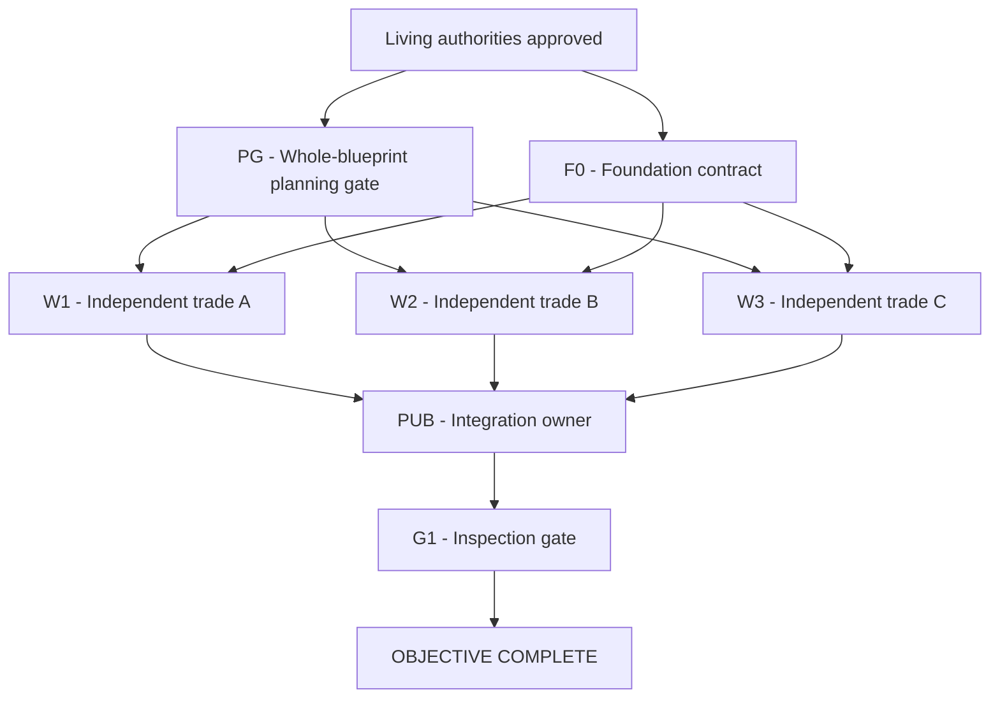

# Blueprint Masterplan Template

## Contents

- Blueprint template
- Graph rules
- Worker brief rules
- Gate rules
- Revision rules

## Blueprint template

Adapt vocabulary and paths to the project. Preserve every section responsibility. Keep worker-level step-by-step specifications and implementation plans outside this masterplan.

````markdown
# <Project> <Objective> Implementation Masterplan

> Frozen execution blueprint for delivering <bounded outcome> through independently owned worker packages.

| Field | Value |
| --- | --- |
| Status | Approved execution snapshot |
| Blueprint ID | `YYYY-MM-DD-<short-slug>` |
| Effective date | <date> |
| Integration authority | `origin/main` |
| Checkout/clone mode | `genuinely shared checkout` / `independent normal clones`; `<machine or incompatibility evidence>` |
| Shared-checkout main-mutation lock | `<exclusive lock name; required for filesystem edits and Git/index operations through remote proof, or not applicable>` |
| Cross-clone main-push lock/queue | `<required reconcile → affected verification → push → ancestry-proof queue, or not applicable>` |
| Coordinator | <role or named owner> |
| Business authority | `<relative path>` |
| Product authority | `<relative path>` |
| Architecture authority | `<relative path>` |
| Existing implementation authority | `<relative path>` |
| Worker specification root | `docs/superpowers/specs/<blueprint-id>/` |
| Worker implementation-plan root | `docs/superpowers/plans/<blueprint-id>/` |
| Coordination root | `docs/workers/<blueprint-id>/` |
| Planning-gate receipt | `docs/workers/<blueprint-id>/PLANNING_GATE.md` |

## 1. How to use this document

State the one execution question this blueprint answers. Explain that living masterplans own approved behavior and current truth; this frozen document owns delivery boundaries, dependencies, gates, and integration mechanics.

Every worker receives:

1. this blueprint;
2. relevant living authorities;
3. its worker ID and bounded brief;
4. prerequisite handoffs;
5. the assigned normal checkout or clone on `main`, including the declared checkout/clone mode;
6. the required shared-checkout main-mutation lock or cross-clone push queue; and
7. the reserved artifact paths, named per-worker status contract, and coordinator `STATUS.md`.

Workers never communicate with one another through Codex chats. They coordinate through `origin/main`, owned status/handoff artifacts, and coordinator-owned summaries. No worker depends on private conversation history, off-main work, or an unpushed local commit. Ordinary execution workers become planning-ready from approved authorities, briefs, and planned contracts; they do not wait for predecessor implementation. They become execution-ready only after the whole-blueprint planning gate passes and their hard implemented prerequisites are integrated. A shared checkout permits parallel read-only planning but requires its exclusive main-mutation lock for filesystem edits and Git/index operations through remote proof. If that lock cannot exist, normal clones are allowed only for different machines or an incompatible checkout; their push queue does not impose a global edit lock. Feature branches and linked Git worktrees are prohibited.

## 2. Outcome and delivery gates

Describe the final bounded outcome and measurable inspection/release gates.

| Gate | Outcome | Hard prerequisites | Evidence | Verifier | Unlocks |
| --- | --- | --- | --- | --- | --- |
| <G1> | <observable milestone> | <worker/gate IDs> | <commands, artifacts, or approval> | <owner> | <IDs> |

Omit a gate without measurable evidence, a verifier, failure ownership, and a downstream consequence.

## 3. Foundation already implemented

List existing modules, infrastructure, components, contracts, migrations, tests, and operational patterns workers must reuse. Cite authorities and repository paths.

State which foundations workers may not duplicate for local convenience.

## 4. Locked boundaries and ownership rules

List the approved product, architecture, security, integration, data, and operational boundaries that determine worker interfaces.

### 4.1 Shared mutable surfaces

| Surface | Single owner | Dependants | Change protocol |
| --- | --- | --- | --- |
| <contract, migration sequence, generated output, central file> | <worker ID> | <IDs> | <merge/evidence required before use> |

## 5. Pre-execution planning and authorization

### 5.1 Conditional live UI design

Add a separate UI-design worker only when its package introduces or changes
visual hierarchy, layout, component treatment, responsive behavior, motion,
interaction states, or interface copy. That worker owns only named presentation
surfaces, edits the real app, uses the conditional live-design prompt, has no
implementation plan, and transfers mutable UI ownership only after its accepted
handoff is integrated. Do not add a UI-design worker when this observable trigger
is absent.

### 5.2 Complete planning set and planning gate

Before ordinary execution, every ordinary execution worker must be
planning-ready and must publish its approved dated specification, non-UI
implementation plan, authority synchronization, downstream propagation, and
planned-contract inputs. Planning dependencies consume approved authorities,
briefs, and planned contracts; they do not require predecessor implementation.

The coordinator reconciles the complete planning set, including each required
UI-design handoff, at one pinned `origin/main` commit. It then owns and writes
`docs/workers/<blueprint-id>/PLANNING_GATE.md` using
`references/planning-gate-template.md`. The gate passes only when every required
row is approved/reconciled, every affected UI implementation plan consumes its
accepted UI-design handoff, and no material contradiction remains. An individual
planning handoff never authorizes execution.

### 5.3 Execution-ready predicate

An ordinary worker is execution-ready only when the planning-gate receipt is
passed at its named `origin/main` commit *and* every hard implementation
prerequisite and required execution evidence for that worker is integrated there.
The gate is a hard prerequisite for every ordinary execution node; it does not
replace the node's existing implemented DAG edges.

## 6. Execution graph



Every ordinary execution node has the planning-gate edge plus its existing
implemented-prerequisite edges. Every arrow is a hard prerequisite satisfied
only by remote integration and required evidence. Describe planning-only and
other coordination relationships outside the graph.

### 6.1 Graph-shape evidence

| Metric | Value | Explanation |
| --- | --- | --- |
| Worker nodes | <count> | <why every package is coherent> |
| Hard dependency edges | <count> | <why every edge requires remote integration> |
| Substantive layer widths | <counts and worker IDs> | <ready frontiers by graph state> |
| Peak ready width | <count and IDs> | <widest logical frontier> |
| Active execution-slot limit | <count> | <capacity, separate from graph width> |
| Width exceptions | <none or layers> | <structural reason outside three to seven> |

For a multi-worker objective, target three to seven concurrently ready workers in each substantive post-foundation trade layer. Do not force roots, joins, gates, closeout, or small objectives into the band. Before accepting a substantive frontier wider than seven, test grouping by domain, protocol, risk, runtime/toolchain, release boundary, and shared verification. Separate files, provider-specific evidence, independent ownership, and open execution slots are not enough. Keep provider tests in coherent adapter bundles where safe; any remaining exception cites concrete incompatible ownership, security/isolation, runtime/toolchain, deployment/release, or verification evidence. Never invent edges, group shared migrations/facades with adapter work, or force a group that documented constraints make unsafe.

### 6.2 Dependency and unblock parity

| ID | Depends on | Unblocks |
| --- | --- | --- |
| <ID> | <IDs or approved authorities> | <IDs and supplied contract/evidence> |

## 7. Readiness and blocker rules

- `planning-blocked`: a required frozen authority, brief, or approved planned contract is unavailable.
- `planning-ready`: the frozen blueprint, brief, relevant living authorities, and approved planned contracts needed to make task decisions are available; implemented predecessor code is not required.
- `planning-in-progress`: the worker is producing required ordinary planning artifacts or a UI-design handoff.
- `planning-complete / execution-blocked`: the worker's artifacts are reconciled, but the global planning gate is open or an implemented hard prerequisite is absent.
- `execution-ready`: the passed planning-gate receipt is pinned to the named `origin/main` commit and every hard implemented prerequisite/evidence is integrated there.
- `unverified`: the relevant `origin/main` commit or evidence has not been inspected; do not label the worker planning-ready or execution-ready.
- `in-progress`: an execution-ready worker claimed its owned scope on `main`, refreshed from `origin/main`, and is producing coherent checkpoints.
- `blocked`: a named dependency, decision, conflict, or external condition prevents progress.
- `review`: work exists but required review, evidence, or integration is open.
- `complete`: the coordinator verified integration, handoff, evidence, and cleanup.

`origin/main` is authoritative. An off-main commit, unpushed local `main` commit, stash, working-tree change, or local “done” claim does not satisfy a planned contract, hard execution prerequisite, planning-gate row, or dependency handoff. The coordinator's initial readiness table is captured at an inspected `origin/main` commit and separates planning readiness from execution readiness, with evidence and blockers for each worker.

## 8. Mandatory lifecycle by worker role

### 8.1 Worker-authored Superpowers planning

1. Enter the assigned normal checkout or clone, prove it is on `main` and is not a linked worktree, record its checkout/clone mode, and acquire the required shared-checkout main-mutation lock before mutation or identify the cross-clone push queue for later reconciliation.
2. Inspect live state without disturbing unrelated dirt, pull `origin/main` only when safe, prove planning-ready authorities, briefs, and planned-contract inputs are integrated there, record authority-refresh results at that inspected commit, and inspect the relevant baseline without running the full suite.
3. Read this blueprint, relevant living authorities, the worker brief, and prerequisite handoffs.
4. Use Superpowers brainstorming for task-local decisions.
5. Write and obtain approval for `docs/superpowers/specs/<blueprint-id>/YYYY-MM-DD-<worker-id>-<topic>-design.md`.
6. Immediately identify every affected product specification masterplan and
   consolidate all approved changes from the dated specification into its unified
   high-level frontend-to-backend product contract, or record an evidence-backed
   no-impact finding.
7. Use `superpowers:writing-plans` to write `docs/superpowers/plans/<blueprint-id>/YYYY-MM-DD-<worker-id>-<topic>.md`.
8. Update affected non-product living authorities with stable approved decisions.
9. After each independently testable planning substep—a coherent plan task or
   subtask with its own focused verification—run that focused verification,
   stage only owned paths, commit directly to `main`, fetch and merge newer
   `origin/main`, rerun affected checks, push, and prove remote reachability
   before beginning the next substep.
10. Hand off the dated specification, product specification updates or no-impact
    findings, approved plan, authority synchronization, cross-plan reconciliation
    inputs, and required downstream propagation together; then stop before
    implementation.

Repeat step 6 whenever the dated specification changes. Do not complete planning
or unblock implementation while an affected product specification masterplan is
stale.

The coordinator reserves these paths but does not author their detailed contents.
This worker's planning handoff is complete only when its approved specification,
non-UI implementation plan, authority synchronization, downstream propagation,
and cross-plan inputs are reachable from `origin/main`. This handoff does not
authorize execution. Ordinary implementation remains prohibited until the
coordinator publishes a passed whole-blueprint planning-gate receipt.

### 8.2 Conditional live UI-design lifecycle

When the observable UI-design trigger applies, use
`references/ui-design-worker-prompt-template.md` for the separate design worker.
It edits only named presentation surfaces in the actual app, has no
implementation plan, and supplies accepted app state, user approval, and its
design handoff to the coordinator before ownership transfers to the named
implementation worker.

### 8.3 Coordinator planning-gate reconciliation

The coordinator reviews all ordinary planning handoffs and required UI-design
handoffs together, verifies their planned interfaces and ownership/ordering
decisions agree, and writes the passed receipt at one pinned `origin/main`
commit. No ordinary worker may start product implementation before that receipt
exists and contains its complete row.

### 8.4 Execution

1. Record the checkout/clone mode, required shared-checkout main-mutation lock or cross-clone push queue, authority-refresh record, and separate planning/execution readiness evidence at an inspected `origin/main` commit. Remote-uninspected findings are `unverified`.
2. Read the worker-authored approved specification and implementation plan,
   the passed `PLANNING_GATE.md` receipt, and its pinned `origin/main` commit.
3. Before editing, verify the receipt is passed, current, contains the worker's
   complete row, and is pinned to the named commit. Stop if it is open,
   reopened, stale, missing the worker row, or pinned to a different commit.
4. Implement only owned surfaces with TDD where applicable.
5. After each independently testable substep—a coherent plan task or subtask
   with its own focused verification—run the relevant focused test segment,
   stage only owned paths, commit directly to `main`, fetch and merge newer
   `origin/main`, rerun affected checks, push, and prove remote reachability
   before beginning the next substep; address review before handoff.
6. After every owned task is finished, refresh again, run the full suite once,
   integrate/push final evidence, leave no owned dirt, and preserve/report any
   unrelated dirt in the assigned checkout.

### 8.5 Main-only execution

All new planning, implementation, review fixes, conflict resolution, and documentation updates happen on checked-out `main`. Do not create, switch to, or continue on feature, worker, review, rescue, integration, or temporary branches. Do not create or use linked Git worktrees, detached HEAD, stash queues, patch queues, or hidden refs as substitute worker lanes.

A genuinely shared checkout requires one exclusive main-mutation lock for all filesystem edits and Git/index operations. Read-only planning may proceed in parallel, but the lock is held from reconciliation through focused verification, staging, commit, push, and remote-reachability proof. If that lock cannot exist, a separate normal clone is allowed only for a different machine or a documented incompatible shared checkout, and every clone remains on `main`. Across those independent clones, a required push lock or queue covers reconciliation, affected focused verification, push, and remote-ancestry proof; it does not impose a global edit lock across the clones. In every mode, stage only owned paths and preserve/report every unrelated change.

Inventory legacy worker branches/worktrees without blocking unrelated owned work. Preserve dirty or uncertain state; integrate coherent committed work into current `main`, run affected focused checks, push `origin/main`, and prove ancestry. Retire only fully integrated dedicated lanes, never a shared or uncertain lane.

### 8.6 Verification and Git synchronization cadence

1. Before work, inspect live state, record checkout/clone mode and its required lock or queue, fetch `origin/main`, reconcile local `main` without removing unrelated dirt, and confirm prerequisites.
2. Define each independently testable substep as a coherent plan task or subtask with its own focused verification, not every edit.
3. After each such substep, run the focused test, stage only owned paths, commit directly to `main`, fetch and merge newer `origin/main`, rerun affected checks, push, and prove remote reachability before the next substep.
4. Before a dependency handoff, prove its coherent commit is reachable from `origin/main`.
5. After all tasks owned by the worker are finished, refresh local/remote `main`, run the full suite once, fix failures, push final evidence, prove remote ancestry, leave no owned dirt, and preserve/report unrelated dirt.

If another checkout wins the push race, preserve all work, use the required lock or queue, fetch and merge the new `origin/main`, rerun affected focused checks, and retry. Never rebase or force-push published `main`. Do not contact another worker through Codex chat; repository evidence and coordinator-owned artifacts are the coordination mechanism.

### 8.7 Living-authority downstream propagation

Whenever a worker changes a living business, product/specification, architecture, implementation, operations, security, release, or custom masterplan:

1. identify every direct and transitive downstream worker or gate;
2. assess changes to dependencies, blockers, contracts, ownership, acceptance, tests, launch instructions, and implementation assumptions;
3. record the impact in owned repository artifacts so the coordinator or document owner can update every relevant downstream brief, specification, plan, prompt, worker status, and coordinator status without direct worker-to-worker Codex chat;
4. mark affected downstream work blocked or not-ready until its documents are current and approved;
5. integrate the authority and downstream-document updates into `origin/main`; and
6. record propagation evidence or an evidence-backed finding of no downstream impact.

If frozen blueprint scope, ownership, dependencies, gates, or completion semantics change, require an approved blueprint revision before affected work continues.

## 9. Worker packages

### Worker <ID> — <task and outcome>

**Depends on:** <worker/gate IDs or approved living authorities>.

**Role:** ordinary execution / conditional UI design.

**UI-design workers only; otherwise remove/omit this entire block.**

**Mandatory pre-edit source-read checklist** — do not abbreviate:

- [ ] Completely read `claude-design/codex/AGENTS.md`.
- [ ] Completely read `claude-design/codex/system-prompt.md`.
- [ ] Completely read every relevant procedure under `claude-design/codex/skills/`.
- [ ] Completely read `.agents/skills/better-ui/SKILL.md`.

**Planning prerequisites:** <approved authorities, briefs, and planned contracts>.

**Hard execution prerequisites:** <implemented worker/gate IDs and evidence, plus planning gate>.

**Owns:** <paths, contracts, records, migrations, generated artifacts, tests, status>.

**Does not own:** <nearby shared or dependant surfaces>.

**Coordination evidence:** <owned artifacts, coordinator summaries, and non-hard contract boundaries; no worker-to-worker Codex chat>.

**Status contract:** `docs/workers/<blueprint-id>/status/<worker-id>.md`; coordinator summary: `docs/workers/<blueprint-id>/STATUS.md`.

**Work outcomes:**

- <bounded outcome>
- <bounded outcome>
- <stable living-authority effect, when applicable>

**Reserved worker artifacts:**

- Ordinary execution worker — Specification: `docs/superpowers/specs/<blueprint-id>/YYYY-MM-DD-<worker-id>-<topic>-design.md`
- Ordinary execution worker — Implementation plan: `docs/superpowers/plans/<blueprint-id>/YYYY-MM-DD-<worker-id>-<topic>.md`
- UI-design worker — Accepted app state, approval evidence, and handoff: `<path>`; implementation plan: not applicable.

**UI-design ownership transfer:** <not applicable, or named presentation surfaces, accepted handoff, and implementation worker that receives them>.

**Acceptance evidence:**

- <exact test, review, artifact, or observable result>
- <negative or conflict-safety evidence>

**Merge condition:** <what must be approved and green before integration>.

**Unblocks:** <worker/gate IDs and supplied contract/evidence>.

Repeat for every worker. Keep one coherent outcome per package. Do not place the worker's step-by-step specification or implementation plan here.

### 9.1 Phase-specific launch prompts

When planning and execution may run in separate sessions or a launch packet is requested, create:

- `docs/workers/<blueprint-id>/prompts/<worker-id>-planning.md`; and
- `docs/workers/<blueprint-id>/prompts/<worker-id>-execution.md`.

The ordinary planning prompt makes the worker author its own reserved
specification/plan, synchronize every affected product specification masterplan
in the same planning substep, and stop before product implementation. The
ordinary execution prompt names the passed planning-gate receipt and pinned
commit, verifies execution readiness, then consumes those approved files and
continues through integrated evidence with no owned dirty state while unrelated
dirt is preserved and reported.

Only for a worker with the observable UI-design trigger, create a separate
live-design prompt from `references/ui-design-worker-prompt-template.md`.

## 10. Shared integration contracts

| Contract | Owner and authority | Consumers | Compatibility/validation | Merge/escalation |
| --- | --- | --- | --- | --- |
| <contract> | <worker and path/schema> | <IDs> | <rules/evidence> | <owner/process> |

## 11. Integration gates

### Gate <ID> — <name>

**Purpose:** <inspection or release decision>.

**Prerequisites:** <worker/gate IDs>.

**Acceptance evidence:**

- <observable criterion and exact evidence>
- <observable criterion and exact evidence>

**Verifier:** <role or named owner>.

**On failure:** <owner, remediation path, and blocked downstream nodes>.

**Unlocks:** <worker/gate/release IDs>.

## 12. Coordination status

- An active worker owns `docs/workers/<blueprint-id>/status/<worker-id>.md`; publish it with coherent progress checkpoints and the final handoff.
- The coordinator alone owns `docs/workers/<blueprint-id>/STATUS.md` when aggregate status is needed.
- Before reporting readiness or blockers, the coordinator inspects and records one `origin/main` commit, writes an authority-refresh record for each cited authority (`path`, inspected remote commit, `current` / `updated` / `blocked`), and labels every remote-uninspected finding `unverified`.
- The initial coordinator table separates every worker's planning readiness from execution readiness, including evidence and blockers; it names the per-worker status contract and `STATUS.md`.
- A clean baseline means reconciled local `main` with no owned dirty state. Preserve/report unrelated dirt rather than treating it as a worker failure or removing it.
- Ready-but-unscheduled workers remain `ready` when execution slots are full.

## 13. Main integration and conflict policy

- Require every editing worker to operate directly on checked-out `main`; prohibit feature branches and linked worktrees.
- Treat `origin/main` as the only integration authority.
- Assign every shared mutable surface one owner.
- Run focused affected tests at meaningful checkpoints; do not run the full suite after every small substep.
- Treat an independently testable substep as a coherent plan task or subtask with its own focused verification. After each one, run the focused check, stage only owned paths, commit directly to `main`, fetch and merge newer `origin/main`, rerun affected checks, push, and prove remote reachability before the next substep.
- Run the full suite only once after all worker-owned tasks finish.
- Regenerate generated files from their authority.
- Coordinate migration ordering through `origin/main`.
- Resolve mechanical owned conflicts and reverify.
- Stop on semantic or cross-owner conflicts.
- In a genuinely shared checkout, require the exclusive main-mutation lock for filesystem edits and Git/index work through remote proof; read-only planning may be parallel. If that lock cannot exist, allow normal clones only for different machines or an incompatible checkout, and require their push lock/queue for reconcile → affected verification → push → ancestry proof. Never impose a global edit lock across independent clones.
- Ban worker-to-worker Codex chat. Propagate living-authority changes through owned repository evidence and coordinator/document-owner updates.
- Never rebase or force-push published `main`.
- Never reset, overwrite, or discard another worker's change to make integration pass.

## 14. Completion, handoff, and cleanup

A worker handoff includes its ID, final local `main` commit/reachable `origin/main`
commit, worker-authored spec/plan, affected product specification masterplan
updates or evidence-backed no-impact findings, living-authority and
downstream-document updates, verification, review, migrations/generated/
operational actions, conflict resolutions, limitations, and downstream unblock.

After all worker-owned tasks finish: refresh local and remote `main`, run the full suite once, prove ancestry from `origin/main`, verify downstream-document propagation, preserve the handoff/status, confirm there is no owned dirty state while unrelated dirt is preserved and reported, and record a completion receipt.

Preserve dirty, unpushed, failing, under-review, or uncertain work. Never reset, overwrite, force-push, or force-clean it.

## 15. Explicit exclusions

List adjacent products, deferred capabilities, speculative infrastructure, and future gates that must not delay the bounded objective.

## 16. Revision policy

Ordinary progress updates status, not this frozen blueprint. A material approved
change to scope, ownership, dependencies, contracts, acceptance, security/privacy
behavior, accepted UI design, or an implementation plan reopens the planning
gate: no new execution begins, directly affected execution pauses safely, every
affected artifact/authority is updated, the complete planning set is reconciled,
and the coordinator publishes a new passed receipt pinned to current
`origin/main`. Already-running unrelated work may continue only with an
evidence-backed no-impact finding in the reopened receipt.

When approved stable information changes scope, ownership, dependencies, gates, or completion:

1. update affected living authorities and consolidate changes from every changed
   worker specification into its affected product specification masterplans, or
   record evidence-backed no impact;
2. identify every directly or transitively affected worker and invalidated assumption;
3. update all relevant downstream briefs, specs, plans, prompts, and statuses through their owners;
4. issue an explicit blueprint revision/replacement;
5. update graph, briefs, prompts/status baseline, and readiness together;
6. integrate the coherent update into `origin/main`; and
7. obtain approval before affected workers continue.
````

## Graph rules

- Use a directed acyclic graph.
- Target three to seven ready workers per substantive post-foundation layer. Before accepting a wider substantive frontier, test domain, protocol, risk, runtime/toolchain, release boundary, and shared-verification grouping; separate files, provider evidence, independent ownership, or free slots are not exceptions on their own.
- Calculate logical width separately from execution-slot capacity.
- Remove serial wrappers without distinct ownership/evidence.
- Keep provider tests in coherent adapter bundles where safe. Any remaining wide-frontier exception needs concrete incompatible ownership, security/isolation, runtime/toolchain, deployment/release, or verification evidence; never invent edges, group a shared migration/facade with adapter work, or force an unsafe group.
- Give every node a stable ID used in the graph, parity table, briefs, gates, and status.
- Draw hard dependencies only; record coordination separately.
- Make gates distinct nodes.
- Verify every arrow against `Depends on` and `Unblocks`.

## Worker brief rules

- One package owns one coherent outcome.
- Create a worker only for non-overlapping ownership, independent evidence, a useful handoff, and lifecycle-worthy work.
- One shared mutable surface has one owner.
- Include contracts, records, migrations, and generated artifacts—not only files.
- Dependants consume merged contracts.
- Reserve worker artifact paths; do not pre-author worker specs/plans.
- Name exact acceptance evidence.

## Gate rules

- Add a gate only for a real inspection/release decision.
- Require measurable evidence, a verifier, failure owner, and downstream consequence.
- Do not call an arbitrary phase a gate.

## Revision rules

Clarifications that do not change behavior may amend the blueprint. Scope, dependency, ownership, gate, or completion changes require an explicit approved revision after living authorities are current.
