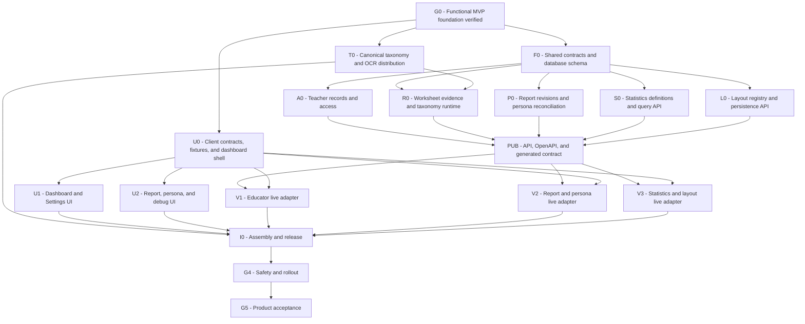

# Blueprint Masterplan Rewrite and MVP2 Consolidation Design

**Status:** Approved by the project owner on 8 August 2026

**Scope:** Rewrite the reusable Blueprint Masterplan skill, consolidate the approved MVP2 execution design into the authoritative implementation masterplan, and remove only the planning artifacts made obsolete by that consolidation.

## 1. Outcomes

1. `blueprint-masterplan` follows the organization and authority boundary demonstrated by `docs/plans/EdenMind_Implementation_Masterplan.md`.
2. A coordinator writes the frozen execution blueprint, graph, gates, shared contracts, worker briefs, prompts when needed, and coordination contract. Each worker writes and owns its own dated Superpowers specification and implementation plan.
3. Superpowers artifacts are grouped by the blueprint start identifier `YYYY-MM-DD-<slug>`:
   - `docs/superpowers/specs/<blueprint-id>/...`
   - `docs/superpowers/plans/<blueprint-id>/...`
4. Multi-worker graphs normally expose three to seven concurrently ready workers in each substantive post-foundation layer. Narrow foundations, joins, gates, and genuinely small objectives remain valid; wider layers require structural justification.
5. `docs/plans/EdenMind_MVP2_Implementation_Masterplan.md` becomes the sole execution authority for a coherent 15-worker graph with layer widths `3 -> 7 -> 1 -> 3 -> 1`.
6. The approved cohesive MVP2 product design remains authoritative and moves into `docs/superpowers/specs/2026-08-07-mvp2/`.
7. The superseded 28-worker graph design, coordinator-authored task plans, and stale prompt/status packets are deleted only after a preservation review proves the new masterplan retains every approved responsibility and product boundary.

## 2. Skill output contract

The frozen blueprint contains, in order:

1. purpose and authority;
2. bounded outcome and measurable gates;
3. foundations workers must reuse;
4. locked product, architecture, security, data, and ownership boundaries;
5. a flattened hard-dependency DAG plus graph-shape evidence;
6. readiness and blocker rules;
7. the worker lifecycle;
8. compact worker briefs;
9. shared integration contracts;
10. gate definitions;
11. coordination, merge, conflict, handoff, teardown, exclusions, and revision rules.

The blueprint does not contain worker-level step-by-step task specifications or implementation plans. It reserves each worker's artifact paths. The planning worker creates and obtains approval for those files after its prerequisites are integrated.

## 3. Blueprint-scoped artifacts

The blueprint identifier is the date the delivery effort began plus a stable slug, not the date each worker happens to start. For MVP2 it is `2026-08-07-mvp2`.

```text
docs/superpowers/specs/2026-08-07-mvp2/
  2026-08-07-mvp2-design.md
  YYYY-MM-DD-<worker-id>-<topic>-design.md

docs/superpowers/plans/2026-08-07-mvp2/
  YYYY-MM-DD-<worker-id>-<topic>.md
```

Do not add a folder per worker. Dates and stable worker IDs keep files ordered inside the one blueprint folder.

## 4. MVP2 worker graph

The graph uses 15 coherent worker packages, 30 hard edges, three gates, and peak ready width seven.



The three roots establish the physical/backend contract, canonical taxonomy/OCR distribution, and client/visual contract. The seven independent trades then implement vertical ownership packages against those merged contracts. Publication remains a single generated-contract owner. Three live-resource adapters run concurrently before one assembly/release owner closes the objective.

## 5. Responsibility preservation

The rewrite preserves the approved Revision 2 responsibilities through this mapping:

| New worker | Absorbed Revision 2 responsibilities |
| --- | --- |
| F0 | K0, DB0 |
| T0 | T0 plus T2; canonical distribution contract used by R0 |
| U0 | U0, C0 |
| A0 | A0, A1, A2 |
| R0 | T1, R0, R1 evidence-facing rules, R2 |
| P0 | P0, P1 plus persona-facing R1 rules |
| S0 | S0, S1 |
| L0 | L0, L1 |
| U1 | U1 |
| U2 | U2, U3 |
| PUB | PUB |
| V1 | V1 |
| V2 | V2 |
| V3 | V3 |
| I0 | V0, I0 |

Shared R1 transition semantics are fixed in F0's contracts and divided by executable ownership: R0 owns report/evidence transitions; P0 owns reconciliation/persona transitions. Neither worker may create a competing event vocabulary.

## 6. Pre-deletion integrity gate

Before deleting any superseded MVP2 specification, plan, prompt, or status file:

1. Compare all 28 current worker briefs and the flat-graph design against the 15 new briefs.
2. Confirm every old responsibility maps to exactly one new worker or an explicit exclusion.
3. Re-read the approved cohesive product design and verify the new masterplan preserves its product, access, privacy, statistics, taxonomy, dashboard, failure, migration, and gate decisions.
4. Check every graph edge against written `Depends on` and `Unblocks` fields and prove acyclicity, node count, edge count, layer widths, and peak width.
5. Check living-authority and repository links after moving the retained product design.
6. Scan for stale W0-W8, 28-worker, flat-graph-design, and deleted-path references.
7. Review the complete diff before the deletion patch.

Deletion is blocked if any mapping is missing, product decision changed, worker owns an incoherent surface, or a surviving document depends on a file marked for deletion.

## 7. Approved deletion boundary

After the integrity gate passes, delete:

- `docs/superpowers/specs/2026-08-08-mvp2-flat-worker-graph-design.md`;
- the nine `docs/superpowers/plans/2026-08-07-mvp2-w*.md` files;
- the 28 `docs/superpowers/plans/2026-08-08-mvp2-*.md` files;
- all 113 stale files under `docs/workers/mvp2-analysis/`; and
- the self-referential `workers-masterplan/blueprint-masterplan/blueprint-masterplan` symlink.

Retain and relocate the approved cohesive design. Preserve unrelated user changes, including the in-progress MVP1 specification organization.

## 8. Verification

- Validate the skill with the bundled skill validator and YAML parser.
- Run skill pressure/application tests for moderate flatness, blueprint-scoped paths, and worker authorship.
- Verify Markdown structure, links, code fences, placeholders, and whitespace.
- Validate the 15-worker graph and responsibility mapping with deterministic scripts.
- Confirm Git shows only intended rewrites, relocation, and approved deletions.
